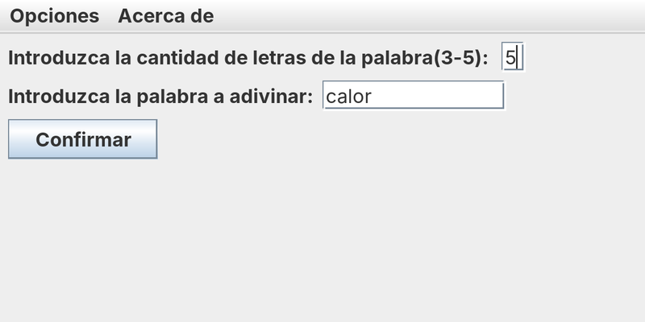
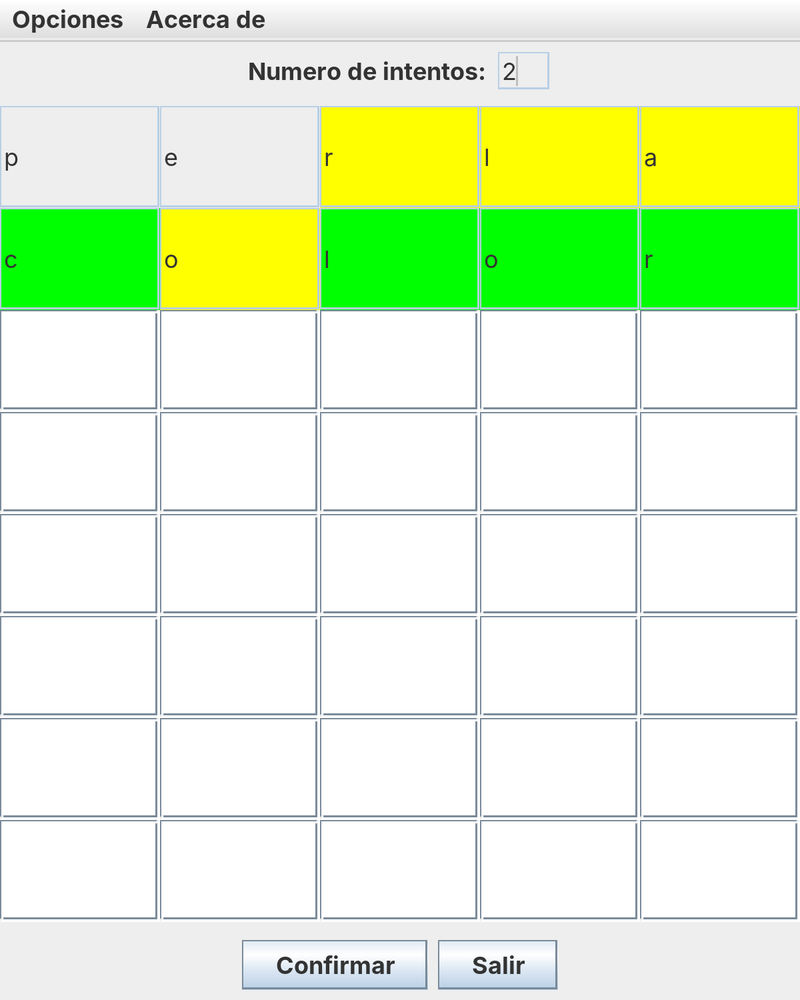
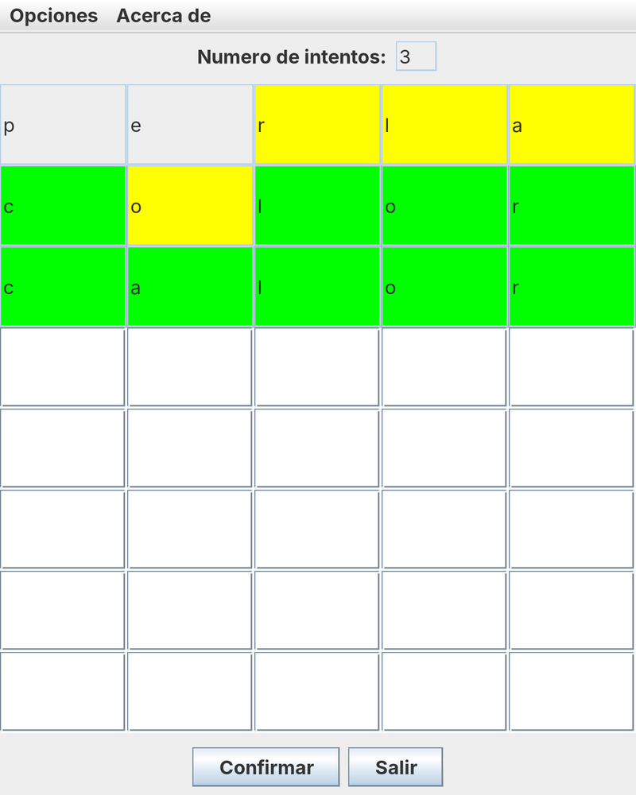

# Wordle 🟩🟨

**Juego de adivinar palabras para dos jugadores, desarrollado en Java con Swing y arquitectura MVC.** El jugador 1 elige una palabra secreta y el jugador 2 tiene ocho intentos para descubrirla. En cada intento, las letras se colorean para indicar si están en su sitio, en otra posición o no aparecen en la palabra.

***

## Capturas de pantalla

Las capturas corresponden a una partida de ejemplo con la palabra secreta **«calor»**.

| 1. El jugador 1 elige la palabra | 2. Partida en curso | 3. Palabra descubierta |
|:---:|:---:|:---:|
|  |  |  |

1. **Ventana del jugador 1.** Indica cuántas letras tiene la palabra (de 3 a 5) y la escribe. Al pulsar *Confirmar* se abre el tablero del jugador 2.
2. **Tablero del jugador 2 tras dos intentos.** El tablero tiene ocho filas, una por intento, y tantas columnas como letras tiene la palabra.
   - Con **«perla»**, la *r*, la *l* y la *a* salen en amarillo porque están en «calor», pero en otra posición. La *p* y la *e* no están en la palabra y no se colorean.
   - Con **«color»**, la *c*, la *l*, la *o* final y la *r* salen en verde porque están en su sitio. La primera *o* sale en amarillo: la palabra tiene una *o*, pero en otra posición.
3. **Victoria.** En el tercer intento, **«calor»**, todas las letras salen en verde. El juego muestra un mensaje de victoria, pide el nombre del jugador y abre el ranking.

***

## Cómo se juega

1. El **jugador 1** escribe la longitud de la palabra (de 3 a 5 letras) y la palabra secreta, y pulsa *Confirmar*.
2. El **jugador 2** escribe una letra en cada casilla de la fila actual y pulsa *Confirmar*. Las casillas de esa fila se bloquean y se colorean:
   - 🟩 **Verde:** la letra está en la palabra y en esa posición.
   - 🟨 **Amarillo:** la letra está en la palabra, pero en otra posición.
   - ⬜ **Sin color:** la letra no está en la palabra.
3. La partida termina con **victoria** si todas las letras de una fila salen en verde, o con **derrota** al agotar los ocho intentos. En los dos casos, el juego pide el nombre del jugador y lo muestra en el ranking junto con los intentos utilizados.

Hay que rellenar todas las casillas de la fila antes de confirmar, y la comparación distingue entre mayúsculas y minúsculas, así que conviene escribir las letras igual que la palabra secreta.

Desde el menú **Opciones** se puede volver a jugar, consultar el ranking o salir, y **Acerca de → Información** muestra los autores.

***

## Estructura del proyecto (MVC)

```
src/
├── proyectofinal/
│   ├── ProyectoFinal.java            Punto de entrada: crea el modelo, las vistas y el controlador
│   ├── ProyectoFinalModel.java       Modelo: palabra, longitud, intentos, victoria y derrota
│   └── ProyectoFinalController.java  Controlador: gestiona los eventos de botones, menús y ventanas
└── ProyectoFinalVista/
    ├── Jugador1Vista.java            Ventana del jugador 1 (longitud y palabra secreta)
    ├── Jugador2Vista.java            Tablero del jugador 2 y corrección de cada intento
    ├── RankingVista.java             Ventana del ranking
    ├── InformacionView.java          Ventana con los autores
    ├── Jugador1Menu.java             Barra de menús común a las ventanas
    └── ImagenVictoria.jpg / ImagenDerrota.jpg
```

El controlador registra un `ActionListener` en cada vista e identifica cada evento por su *action command*: `botonConfirmar1` empieza la partida, `botonConfirmar2` corrige el intento, e `itemJugar`, `itemRanking`, `itemSalir` e `itemInformacion` corresponden a las opciones del menú. Con los datos que lee de las vistas actualiza el modelo y decide qué ventana mostrar.

***

## Tecnologías utilizadas

- **Java** (JDK 15 o posterior).
- **Swing**: `JFrame`, `JMenuBar`, `JTextField`, `JButton`, `GridLayout`, `BorderLayout` y `JOptionPane`.
- **Programación orientada a eventos** con `ActionListener` y `WindowAdapter`.
- **Patrón Modelo-Vista-Controlador.**
- **NetBeans** (proyecto Ant).

***

## Cómo ejecutarlo

### Con NetBeans

Abre la carpeta del repositorio como proyecto y pulsa *Run*. La clase principal es `proyectofinal.ProyectoFinal`.

### Desde la terminal

```bash
git clone https://github.com/oscarherreross/Wordle.git
cd Wordle
javac -encoding UTF-8 -d build/classes $(find src -name "*.java")
java -cp build/classes:src proyectofinal.ProyectoFinal
```

En Windows, separa las rutas del classpath con `;` en lugar de `:`. Se incluye `src` en el classpath para que el juego encuentre las imágenes de victoria y derrota.

***

## Posibles mejoras

- **Ranking:** actualizarlo solo al terminar cada partida (ahora se escribe una fila en cada intento) y ordenarlo por resultado.
- **Puntuación:** el modelo empieza con 8 puntos y tiene un método para descontarlos, pero todavía no se usa ni se muestra.
- **Palabra secreta:** ocultarla mientras se escribe (con un `JPasswordField`) y comprobar que tiene la longitud indicada.
- **Corrección:** comparar las letras sin distinguir mayúsculas y minúsculas, y avisar si falta alguna casilla por rellenar.
- **Código:** calcular las casillas de cada fila como `intento × longitud` en lugar de enumerar todos los casos en `comprobarCasillas()`.

***

## Autores

Desarrollado por **Óscar** y **Ángel** como proyecto final de asignatura.
